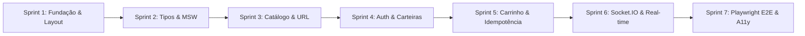

# NFT Nexus: Marketplace Descentralizado de Arte Digital

Uma plataforma descentralizada completa de alta performance para descoberta, cotação, aquisição e liquidação de NFTs, construída sob a arquitetura de **Fatias Verticais (Vertical Slice Architecture)**, tipagem estrita de ponta a ponta com TypeScript, sincronização em tempo real via WebSocket simulado e cobertura integral de testes E2E com Playwright.

---

## 1. Arquitetura e Decisões de Engenharia

O projeto foi projetado com foco em resiliência, manutenibilidade e experiência do usuário no ecossistema Web3:

```text
src/
├── app/                        # Bootstrap, Root Providers e Composição
│   ├── providers/
│   │   ├── QueryProvider.tsx   # TanStack Query v5 com caching e retry configurados
│   │   ├── AuthProvider.tsx    # Sessão JWT reativa com hidratação e interceptors
│   │   ├── SocketProvider.tsx  # Conexão de WebSocket/Socket.IO e ciclo de vida
│   │   └── index.tsx           # Provedor raiz unificado
│   └── main.tsx                # Ponto de entrada React 18 e inicialização do MSW
├── routes/                     # TanStack Router com roteamento tipado por arquivos
│   ├── __root.tsx              # Layout base (Navbar, Footer, Toaster, DevTools)
│   ├── index.tsx               # / (Catálogo de NFTs com busca e filtros sincronizados na URL)
│   ├── nfts/
│   │   └── $nftId.tsx          # /nfts/:nftId (Detalhes, galeria em alta resolução, histórico)
│   ├── cart.tsx                # /cart (Carrinho, cupons promocionais e resumo financeiro)
│   ├── checkout/
│   │   ├── index.tsx           # /checkout (Seleção de carteira, rede, Idempotency-Key)
│   │   └── success.tsx         # /checkout/success (Recibo congelado imutável e TxHash)
│   ├── auth/
│   │   ├── login.tsx           # /auth/login (Login e conexão rápida com carteira)
│   │   └── register.tsx        # /auth/register (Cadastro de colecionador)
│   └── profile/
│       ├── _auth.tsx           # Route Guard protegendo rotas privadas
│       ├── _auth.index.tsx     # /profile (Dashboard consolidado, Meus NFTs e Favoritos)
│       └── _auth.wallets.tsx   # /profile/wallets (Gerenciamento de carteiras Web3)
├── features/                   # Fatias Verticais de Domínio
│   ├── auth/                   # Autenticação, schemas Zod e formulários
│   ├── catalog/                # Cards de NFT, grid responsivo, filtros e ordenação
│   ├── cart/                   # Carrinho, cotações, cupons e reconciliação em tempo real
│   ├── checkout/               # Checkout seguro, seletor de carteira e idempotência
│   ├── profile/                # Dashboard de perfil, saldo em ETH e carteiras
│   └── favorites/              # Gestão de favoritos com mutação otimista
├── components/                 # Componentes compartilhados e UI Primitives
│   ├── ui/                     # Design System baseado em Radix UI / shadcn/ui
│   └── layout/                 # Navbar, MobileNav, Footer
├── lib/                        # Infraestrutura, clientes e utilitários
│   ├── api-client.ts           # Axios configurado com interceptors de JWT e 401
│   ├── socket-client.ts        # Cliente tipado de eventos do Socket.IO
│   ├── decimal.ts              # Aritmética decimal de precisão para ETH (BigNumber.js)
│   ├── query-keys.ts           # Factory unificada de chaves do TanStack Query
│   └── utils.ts                # Utilitários de formatação de ETH e hashes
├── mocks/                      # Mock Service Worker (MSW) e estado simulado
│   ├── browser.ts              # Setup do Service Worker no navegador
│   ├── db/
│   │   ├── state.ts            # Repositório em memória persistido em localStorage
│   │   ├── seed.ts             # Dados iniciais e rotina de reset de banco
│   │   └── fixtures/           # Entidades pré-configuradas (NFTs, usuários, carteiras)
│   ├── handlers/               # Handlers REST para Auth, Catálogo, Carrinho, Pedidos, etc.
│   └── socket/
│       └── socket-mock.ts      # Simulador de eventos WebSocket e triggers de teste
└── types/                      # Contratos TypeScript do sistema
    ├── entities.ts             # Entidades de domínio (NFT, User, Cart, Order, Wallet)
    ├── api.ts                  # Envelopes de requisições e respostas REST
    └── events.ts               # Tipagem canônica de eventos Socket.IO
```

### 1.1 Destaques Técnicos

1. **Sincronização de Filtros na URL via TanStack Router:**
   - O estado do catálogo (busca por texto, categoria selecionada, ordenação, faixa de preço mínima/máxima e página atual) é refletido diretamente nos search parameters da URL.
   - Qualquer recarregamento de página (`F5`) ou compartilhamento de link preserva o estado de visualização do usuário.

2. **Aritmética Decimal Segura para ETH (`BigNumber.js`):**
   - Eliminação completa de erros de ponto flutuante binário (`0.1 + 0.2 !== 0.3`).
   - Todos os cálculos de subtotal, descontos de cupons (`NEXUS10`, `CRYPTO20`), taxa de gas da rede e montante total utilizam o módulo `Decimal` em `src/lib/decimal.ts`.

3. **Garantia de Idempotência em Pagamentos e Pedidos:**
   - O fluxo de checkout gera uma chave RFC4122 v4 UUID (`Idempotency-Key`) injetada no cabeçalho HTTP da requisição `POST /api/orders`.
   - O handler MSW calcula um hash estrito do payload (combinação de `quoteId`, `walletAddress` e `network`). Se a chave for reenviada com o mesmo corpo, a resposta é entregue a partir do cache sem recriar o pedido. Se o corpo for divergente, a API rejeita com status `409 Conflict`.

4. **Reconciliação e Tempo Real com Mock de Socket.IO:**
   - O hook `useCartReconciliation` escuta eventos do WebSocket simulado (`nft.updated` e `order.updated`).
   - Se o criador alterar o preço de uma obra enquanto ela estiver no carrinho do comprador, o sistema exibe um alerta visual com comparação de preços e **bloqueia o botão de checkout** até que o usuário aceite explicitamente o novo valor.
   - Eventos obsoletos ou fora de ordem são descartados comparando o número sequencial de versão (`version`).

5. **Recibo Congelado Imutável:**
   - Ao finalizar a compra, o pedido armazena um snapshot completo dos itens no exato instante da confirmação, garantindo integridade contábil e impedindo que mutações futuras no catálogo alterem o recibo histórico.

---

## 2. Metodologia de Desenvolvimento (AI-Assisted Workflow)

O projeto foi executado através de uma metodologia rigorosa de **Engenharia em Sprints com Agente Autônomo de IA (Google Antigravity)**:



### Princípios Aplicados na Execução Autônoma:
- **Execução Fatiada e Validação Contínua:** Cada sprint foi implementada de maneira estanque, validando a integridade das interfaces TypeScript (`tsc --noEmit`) e do build de produção antes do avanço para a etapa seguinte.
- **Zero Mocking em Componentes de UI:** Nenhum componente contém dados estáticos ou tipos `any`; todas as leituras e mutações passam pela camada de hooks do TanStack Query integrados ao Axios e interceptados pelo MSW.
- **Diagnóstico e Resolução Autônoma de Edge Cases:**
  - Tratamento do escopo de Service Worker no ambiente de automação Playwright através de flags de prontidão de runtime (`window.__MSW_READY__`).
  - Prevenção de condições de corrida durante transições pós-login imediatas no React 18 com checagem de hidratação de sessão nos Route Guards.
  - Mitigação de invalidação indevida de queries durante atualizações de cotação em tempo real.

---

## 3. Guia de Instalação e Execução

### Pré-requisitos
- **Node.js:** Versão 18.0.0 ou superior (testado com Node.js LTS v26.13.0)
- **npm:** Versão 9.0.0 ou superior

### 1. Clonar e Instalar Dependências
```bash
git clone <url-do-repositorio>
cd "Marketplace de NFTs"
npm install
```

### 2. Iniciar Ambiente de Desenvolvimento
```bash
npm run dev
```
Acesse a aplicação no seu navegador em: `http://localhost:3000`

### 3. Verificar Tipagem TypeScript (Linter / Type-Check)
```bash
npm run lint
```
Executa a compilação do TypeScript (`tsc --noEmit`) garantindo zero erros de tipos.

### 4. Gerar Build de Produção
```bash
npm run build
```
Compila e empacota a aplicação com otimização de assets no diretório `dist/`.

### 5. Executar a Suíte de Testes E2E (Playwright)
```bash
npm run test:e2e
```
Executa todos os testes ponta a ponta no Chromium em modo headless.

Para executar os testes com interface interativa:
```bash
npx playwright test --ui
```

---

## 4. Matriz de Cobertura de Testes E2E (Playwright)

A suíte em `e2e/` cobre os cenários críticos do marketplace com 100% de sucesso:

| Teste | Arquivo | Cenário Verificado | Status |
| :--- | :--- | :--- | :--- |
| **Fluxo Crítico de Compra** | `e2e/checkout-flow.spec.ts` | Login do usuário, busca no catálogo, seleção de NFT, adição ao carrinho, aplicação de cupom `NEXUS10`, checkout idempotente e conferência do recibo imutável | ✅ Passou |
| **Garantia de Idempotência** | `e2e/idempotency.spec.ts` | Retorno da resposta original em cache para a mesma `Idempotency-Key` com o mesmo payload | ✅ Passou |
| **Proteção contra Conflito** | `e2e/idempotency.spec.ts` | Rejeição com status `409 Conflict` ao tentar reutilizar a mesma `Idempotency-Key` com payload divergente | ✅ Passou |
| **Reconciliação em Tempo Real** | `e2e/realtime-reconciliation.spec.ts` | Disparo de evento `nft.updated` via Socket.IO mock, exibição de alerta no carrinho, bloqueio do checkout e liberação após aceite do comprador | ✅ Passou |
| **Persistência Pós-Checkout** | `e2e/checkout-persistence.spec.ts` | Débito dinâmico do saldo da carteira do usuário e adição imediata dos NFTs adquiridos à aba "Meus NFTs" no perfil | ✅ Passou |
| **Sincronização de Filtros na URL** | `e2e/catalog-filters.spec.ts` | Atualização da URL via debounce ao digitar na busca e persistência total dos filtros após recarregamento (`F5`) | ✅ Passou |
| **Filtro por Categorias** | `e2e/catalog-filters.spec.ts` | Filtragem facetada por categoria e sincronização com parâmetros de busca na URL | ✅ Passou |

---

## 5. Acessibilidade (a11y) e Conformidade WCAG

O projeto foi construído respeitando as melhores práticas de acessibilidade e navegabilidade:
- **Navegação por Teclado:** Suporte completo a navegação sequencial via `Tab` e atalhos em modais e gavetas (`Escape` para fechamento, `Enter`/`Space` para ativação).
- **Gerenciamento de Foco:** Modais e painéis gaveta (Radix UI `Dialog` e `Drawer` via Vaul) implementam *focus trapping* automático e restauração de foco ao fechar.
- **Rótulos ARIA:** Elementos interativos possuem atributos semânticos explícitos (`aria-label`, `role`, `aria-expanded`, `aria-live`).
- **Paleta de Alto Contraste:** Tema escuro Web3 projetado com proporções de contraste que atendem aos critérios de conformidade **WCAG AA**.

---

## 6. Credenciais de Demonstração (Seed Mock)

Para testar os fluxos autenticados e carteiras:

| Campo | Colecionador Demo | Criador Demo |
| :--- | :--- | :--- |
| **E-mail** | `pedro@nexus.io` | `ana@cyber.art` |
| **Senha** | `password123` | `password123` |
| **Carteira Principal** | `0x71C8...5a72` (4.85 ETH) | `0x3a4b...1e0f` (12.40 ETH) |
| **Cupons Ativos** | `NEXUS10` (10% OFF), `CRYPTO20` (20% OFF) | — |

---

## 7. Licença e Direitos

Projeto desenvolvido como parte do desafio técnico de engenharia de software frontend descentralizado. Licença MIT.
